<p align="center">
  
</p>

<br/>

<div align='center'>

<p>
  <a href="./LICENSE"></a>
  <a href="https://vercel.com"></a>
  <a></a>
  
</p>

<p>
  <a href="https://fiap-achievements.vercel.app/home"><strong>Site</strong></a>
  &nbsp;·&nbsp;
  <a href="https://fiap-achievements.vercel.app/catalog"><strong>Catálogo</strong></a>
  &nbsp;·&nbsp;
  <a href="#-início-rápido"><strong>Início Rápido</strong></a>
  &nbsp;·&nbsp;
  <a href="#-referência-da-api"><strong>API</strong></a>
  &nbsp;·&nbsp;
  <a href="https://github.com/leoosilvp/fiap-achievements/issues"><strong>Reportar Bug</strong></a>
  &nbsp;·&nbsp;
  <a href="https://github.com/leoosilvp/fiap-achievements/issues"><strong>Solicitar Badge</strong></a>
</p>

</div>

---

**FIAP Achievements** é um serviço open-source que permite que estudantes exibam suas conquistas da FIAP — Nano Courses, Challenges, Global Solutions e Iniciação Científica — diretamente no GitHub, portfólios e qualquer lugar que renderize imagens HTML.

Cada badge é um **SVG gerado dinamicamente pelo backend** a partir de um único arquivo de dados, disponível em sete temas e com suporte a customização de cores via parâmetros de URL. Nenhuma chave de API. Nenhum cadastro. Apenas uma ``.

---

## Índice

- [🌐 Site e Catálogo](#-site-e-catálogo)
- [🚀 Início Rápido](#-início-rápido)
- [📡 Referência da API](#-referência-da-api)
  - [GET /api/badge](#get-apibadge)
  - [GET /api/catalog](#get-apicatalog)
  - [Parâmetros de Badge](#parâmetros-de-badge)
  - [Parâmetros de Cor](#-parâmetros-de-cor)
  - [Tipos de Badge](#tipos-de-badge)
  - [Temas](#-temas)
  - [Cabeçalhos de Resposta](#cabeçalhos-de-resposta)
- [💡 Exemplos de Uso](#-exemplos-de-uso)
- [🏗️ Arquitetura](#️-arquitetura)
- [⚙️ Rodando Localmente](#️-rodando-localmente)
- [🤝 Contribuindo](#-contribuindo)
- [🔒 Segurança](#-segurança)
- [📄 Licença](#-licença)

---

## 🌐 Site e Catálogo

A forma mais fácil de encontrar suas badges é pelo site — sem precisar decorar IDs ou slugs.

| Página | URL | O que você encontra |
|--------|-----|---------------------|
| **Home** | [fiap-achievements.vercel.app/home](https://fiap-achievements.vercel.app/home) | Visão geral do projeto e como usar |
| **Catálogo** | [fiap-achievements.vercel.app/catalog](https://fiap-achievements.vercel.app/catalog) | Todas as badges com busca, filtros e preview em tempo real |

> No catálogo você encontra os IDs dos Nano Courses e os slugs de Challenge, Global Solution e I.C que precisa para montar sua URL.

---

## 🚀 Início Rápido

### Nano Course

```html

```

### Challenge

```html

```

### Global Solution

```html

```

### Iniciação Científica

```html

```

**Pré-visualização de qualquer badge:**

```
https://fiap-achievements.vercel.app/badge?badge=SEU_ID&theme=carbon
```

> **Onde encontrar os valores?** Acesse o [Catálogo](https://fiap-achievements.vercel.app/catalog) ou consulte a [Referência da API](#-referência-da-api) abaixo.

---

## 📡 Referência da API

### `GET /api/badge`

Gera e retorna o SVG da badge solicitada. **Sempre retorna `HTTP 200` com `Content-Type: image/svg+xml`** — em caso de erro, serve um SVG de erro temático. A tag `` nunca quebra.

---

### `GET /api/catalog`

Retorna o catálogo completo de badges disponíveis em formato JSON, com URLs prontas para cada tema.

| Parâmetro | Tipo | Obrigatório | Descrição |
|-----------|------|:-----------:|-----------|
| `type` | `string` | ❌ | Filtra por tipo: `nano`, `challenge`, `gs`, `ic`. Sem `type`, retorna o catálogo completo. |
| `year` | `number` | ✅ challenge / gs / ic | Ano da edição |
| `company` | `string` | ✅ challenge | Slug da empresa |
| `topic` | `string` | ✅ gs | Slug do tema |

**Exemplo de resposta (catálogo completo):**

```
GET /api/catalog
```

```json
{
  "success": true,
  "mode": "catalog",
  "data": {
    "nano": {},
    "challenge": {
      "2026": [{ "title": "Jovi", "slug": "jovi", "type": "challenge", "year": 2026 }]
    },
    "gs": {
      "2025": [{ "title": "Future Of Work", "slug": "future-of-work", "type": "gs", "year": 2025 }]
    },
    "ic": {
      "2025": [{ "title": "Synaptic Cockpit", "slug": "1", "type": "ic", "year": 2025, "ranking": "1" }]
    }
  }
}
```

**Exemplo de resposta (tipo específico):**

```
GET /api/catalog?type=nano
```

```json
{
  "success": true,
  "mode": "badges",
  "data": {
    "title": "Nano Courses",
    "slug": "nano",
    "type": "nano",
    "total": 95,
    "badges": [
      {
        "id": "294870",
        "name": "Java Enterprise Development",
        "hours": 60,
        "themes": {
          "carbon": "/api/badge?badge=294870&theme=carbon",
          "dark": "/api/badge?badge=294870&theme=dark",
          "light": "/api/badge?badge=294870&theme=light"
        }
      }
    ]
  }
}
```

---

### Parâmetros de Badge

| Parâmetro | Tipo | Obrigatório | Padrão | Descrição |
|-----------|------|:-----------:|--------|-----------|
| `badge` | `string` | ✅ | — | ID numérico do Nano Course **ou** tipo: `challenge`, `gs`, `ic` |
| `theme` | `string` | ❌ | `carbon` | Tema visual (ver [Temas](#-temas)) |
| `year` | `number` | ✅ challenge / gs / ic | — | Ano da edição (ex: `2025`) |
| `company` | `string` | ✅ challenge | — | Slug da empresa parceira (ex: `oracle`) |
| `topic` | `string` | ✅ gs | — | Slug do tema da G.S. (ex: `future-of-work`) |
| `ranking` | `number` | ❌ challenge / ic | `1` | Posição: `1`, `2` ou `3` |

---

### 🎨 Parâmetros de Cor

Além dos temas pré-definidos, é possível sobrescrever qualquer cor da paleta individualmente via query string. Os valores devem ser hexadecimais — com ou sem `#`.

| Parâmetro | Aliases | Controla |
|-----------|---------|---------|
| `bg` | `background` | Cor de fundo |
| `text` | `text_color` | Cor do texto principal |
| `muted` | `muted_color` | Cor do texto secundário |
| `accent` | `accent_color` | Cor de destaque e ícone |
| `edge` | `edge_color` | Cor da borda externa |
| `line` | `line_color` | Cor das linhas divisórias |

**Exemplo — badge com fundo customizado:**

```
/api/badge?badge=294870&theme=carbon&bg=1a1a2e&accent=e94560
```

> As cores são sanitizadas pelo backend: apenas valores hexadecimais válidos são aceitos. Nenhum valor arbitrário é injetado no SVG.

---

### Tipos de Badge

| Tipo | `badge=` | Parâmetros obrigatórios |
|------|----------|------------------------|
| Nano Course | ID numérico | — |
| Challenge | `challenge` | `year`, `company` |
| Global Solution | `gs` | `year`, `topic` |
| Iniciação Científica | `ic` | `year` |

---

### 🎨 Temas

Sete temas disponíveis. Escolha o que melhor combina com o fundo do seu perfil.

| Tema | Parâmetro | Ideal para |
|------|-----------|------------|
| Carbon | `carbon` | Estética tech com alto contraste *(padrão)* |
| Dark | `dark` | READMEs e perfis com fundo escuro |
| Light | `light` | READMEs e portfólios com fundo claro |
| Black | `black` | Fundos OLED / preto total |
| Pink | `pink` | Perfis com identidade visual vibrante |
| Panda | `panda` | Dark com acentos em azul e rosa |
| Dracula | `dracula` | Paleta clássica do tema Dracula |

&nbsp;&nbsp;&nbsp;&nbsp;&nbsp;&nbsp;

---

### Cabeçalhos de Resposta

| Cabeçalho | Badge encontrada | Fallback / Erro |
|-----------|-----------------|-----------------|
| `Content-Type` | `image/svg+xml` | `image/svg+xml` |
| `Cache-Control` | `public, immutable, max-age=31536000` | `public, max-age=60` |
| `X-Badge-Status` | `ok` | `not-found` · `bad-request` · `internal-error` |

Badges ficam em cache por **1 ano** na CDN — carregam instantaneamente em qualquer lugar.

---

## 💡 Exemplos de Uso

### Nano Course

&nbsp;&nbsp;

```html
<div align="center">
  
  
  
</div>
```

---

### Challenge

&nbsp;&nbsp;

```html

```

---

### Global Solution


```html

```

---

### Iniciação Científica

&nbsp;&nbsp;

```html

```

---

### Cor customizada


```html

```

---

### Portfólio completo

```html
<div style="display: flex; gap: 16px; flex-wrap: wrap; justify-content: center;">
  
  
  
  
</div>
```

---

## 🏗️ Arquitetura

```
fiap-achievements/
├── api/
│   ├── badge.js                   # Serverless function — gera o SVG dinamicamente
│   └── catalog.js                 # Serverless function — retorna o catálogo em JSON
├── public/
│   └── assets/
│       ├── img/
│       └── svg/
│           ├── logo.svg
│           ├── icon.svg
│           └── error.svg
├── src/
│   ├── components/
│   │   ├── Header.jsx
│   │   └── Footer.jsx
│   ├── routes/
│   │   ├── Home.jsx               # Página inicial (/home)
│   │   ├── Catalog.jsx            # Catálogo interativo (/catalog)
│   │   └── Badges.jsx             # Pré-visualização (/badge)
│   ├── hooks/
│   │   └── useCatalog.js
│   ├── utils/
│   │   └── achievements.json      # Fonte de dados de todas as badges
│   ├── css/
│   ├── App.jsx
│   └── main.jsx
├── .github/
│   ├── workflows/
│   │   └── ci.yml                 # Lint e build em todo PR/push para main
│   └── pull_request_template.md
├── vercel.json
└── vite.config.js
```

**Rotas da aplicação:**

| Rota | Descrição |
|------|-----------|
| `/home` | Página inicial com visão geral do projeto |
| `/catalog` | Catálogo interativo com busca e filtros |
| `/badge` | Pré-visualização de qualquer badge por parâmetros de URL |
| `/api/badge` | Gera e retorna o SVG da badge solicitada |
| `/api/catalog` | Retorna o catálogo completo ou filtrado em JSON |

**Fluxo da API:**

```
GET /api/badge?badge=...&theme=...
  │
  ├─ lê achievements.json
  ├─ aplica tema + overrides de cor via query string
  │
  ├─ badge numérico  →  Nano Course   →  gera SVG com nome + horas do curso
  ├─ badge=challenge →  Challenge     →  gera SVG com empresa, ano e ranking
  ├─ badge=gs        →  G. Solution   →  gera SVG com tópico e ano
  └─ badge=ic        →  I. Científica →  gera SVG com projeto e ranking
       │
       ├─ dados encontrados    →  SVG temático + cache 1 ano
       └─ dados não encontrados →  SVG de erro  + cache 60s
```

---

## ⚙️ Rodando Localmente

**Pré-requisitos:** Node.js ≥ 18, npm

```bash
# 1. Clone o repositório
git clone https://github.com/leoosilvp/fiap-achievements.git
cd fiap-achievements

# 2. Instale as dependências
npm install

# 3. Inicie o servidor de desenvolvimento
npm run dev
```

> **Atenção:** os endpoints `/api/badge` e `/api/catalog` requerem o runtime da Vercel. Use a [Vercel CLI](https://vercel.com/docs/cli) para suporte completo ao backend local.

```bash
npm i -g vercel
vercel dev
```

---

## 🤝 Contribuindo

Contribuições são bem-vindas e ajudam a expandir o catálogo da comunidade.

### Como funciona

Todas as badges são geradas dinamicamente pelo backend a partir de um único arquivo:

```
src/utils/achievements.json
```

Não há SVGs estáticos ou estrutura de pastas para manter. Para adicionar qualquer badge, basta editar o JSON com os dados corretos.

---

### Estrutura do JSON

O arquivo `achievements.json` segue esta estrutura (3 exemplos por seção):

```jsonc
{
  "Achievements": {

    // Nano Courses — chave = nome do curso em PT-BR
    "Nano Courses": {
      "Android": {
        "id": 864195,          // ID numérico usado na URL (/api/badge?badge=864195)
        "name_en": "Android",  // Nome em inglês (exibido na badge)
        "hours": 80            // Carga horária do curso
      },
      "Blockchain": {
        "id": 507934,
        "name_en": "Blockchain",
        "hours": 40
      },
      "Python": {
        "id": 284705,
        "name_en": "Python",
        "hours": 80
      }
      // ...
    },

    // Challenges — ano → array com nomes das empresas parceiras
    "Challenges": {
      "2026": [
        "Jovi",
        "Oracle",
        "TOTVS"
        // ...
      ],
      "2025": [
        "B3",
        "Oracle",
        "Vivo"
        // ...
      ]
    },

    // Global Solutions — ano → array com nomes dos temas
    "Global Solutions": {
      "2026": [ "Space Connect" ],
      "2025": [ "Future Of Work", "Protech the Future" ],
      "2024": [ "Green Energy", "Blue Economy" ]
    },

    // Iniciação Científica — ano → ranking → nome do projeto
    "I.C": {
      "2025": {
        "1": "Synaptic Cockpit",
        "2": "SandBox",
        "3": "BEE ARM"
      }
    }

  },
  "Metadata": {
    "last_updated": "YYYY-MM-DD"
  }
}
```

---

### Adicionando Nano Courses

Abra `src/utils/achievements.json` e adicione uma nova entrada em `"Nano Courses"`:

```json
"Nome do Curso": {
  "id": 000000,
  "name_en": "Course Name in English",
  "hours": 60
}
```

> O `id` deve ser único dentro de `Nano Courses` e corresponder ao ID real do curso na plataforma FIAP.

---

### Adicionando Challenges

Adicione o nome da empresa no array do ano correspondente em `"Challenges"`:

```json
"Challenges": {
  "2026": [
    "Nome da Empresa"
  ]
}
```

> Use o nome de exibição exato da empresa. O slug para a URL é derivado automaticamente pelo backend via `slugify`.

---

### Adicionando Global Solutions

Adicione o nome do tema no array do ano correspondente em `"Global Solutions"`:

```json
"Global Solutions": {
  "2026": [
    "Nome do Tema"
  ]
}
```

---

### Adicionando Iniciação Científica

Adicione os projetos do ano com seus respectivos rankings em `"I.C"`:

```json
"I.C": {
  "2026": {
    "1": "Nome do Projeto Vencedor",
    "2": "Nome do 2º Colocado",
    "3": "Nome do 3º Colocado"
  }
}
```

---

### Regras Gerais

- Atualize `"Metadata"."last_updated"` com a data de hoje no formato `YYYY-MM-DD`
- Não duplique entradas dentro do mesmo tipo e ano
- Use o nome de exibição oficial da empresa, tema ou curso
- Abra um Pull Request com descrição clara — o template guia o preenchimento

### Ambiente de Desenvolvimento

```bash
npm install     # instalar dependências
npm run dev     # servidor local (frontend)
npm run lint    # lint
npm run build   # build de produção
vercel dev      # servidor local com suporte aos endpoints /api/*
```

---

## 🔒 Segurança

Todos os parâmetros fornecidos pelo usuário são sanitizados antes de qualquer uso — apenas `[a-z0-9\-_]` é permitido em slugs, apenas dígitos em valores numéricos e apenas hexadecimais válidos nos parâmetros de cor. A API nunca expõe dados além do necessário para gerar o SVG e nunca retorna uma página de erro HTTP.

---

## 📄 Licença

Distribuído sob a [Licença MIT](./LICENSE).

---

<div align="center">

Lets Rock The Future

</div>